<p align="center">
  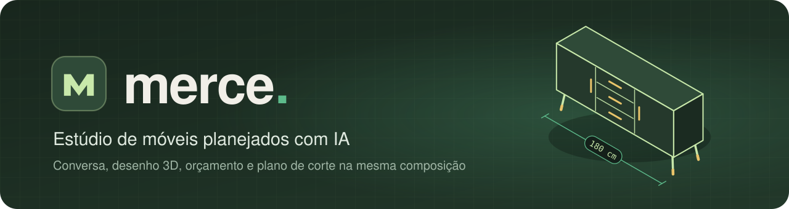
</p>

<p align="center">
  <a href="https://github.com/lucferreira-27/MercePOC/actions/workflows/deploy.yml"></a>
  <a href="https://github.com/lucferreira-27/MercePOC/releases"></a>
  
  
  
  
  
</p>

<p align="center">
  <a href="https://merce.lucferreira14.workers.dev"><strong>Abrir o app</strong></a>
  &nbsp;·&nbsp;
  <a href="#o-que-ele-faz">O que ele faz</a>
  &nbsp;·&nbsp;
  <a href="#como-rodar">Como rodar</a>
  &nbsp;·&nbsp;
  <a href="https://github.com/lucferreira-27/MercePOC/releases">Novidades</a>
  &nbsp;·&nbsp;
  <a href="docs/STYLES.md">Guia de estilos</a>
</p>

<br>

O **Merce** é um estúdio de móveis planejados. Você descreve o móvel na conversa, parte de um modelo pronto ou monta no editor, e o estúdio devolve o desenho em 3D no seu ambiente, o orçamento, o plano de corte e os arquivos para a marcenaria. Conversa, editor, cena 3D, histórico, orçamento e corte leem a mesma composição, então tudo acompanha cada versão.

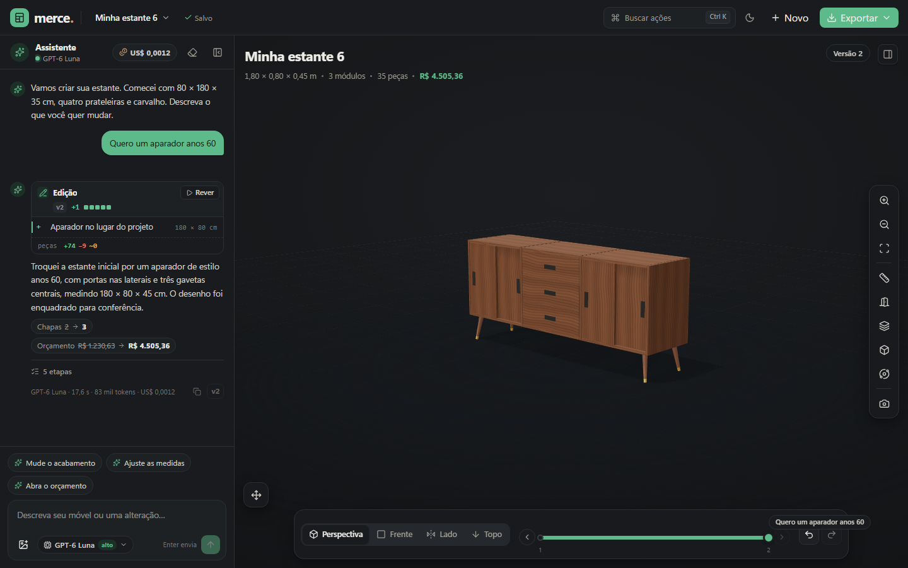

<div align="center">

| **30** móveis | **12** estilos | **31** materiais | **8** frentes | **16** bases | **6** exportações |
|:-:|:-:|:-:|:-:|:-:|:-:|

</div>

## O que ele faz

### Peça na conversa, veja cada mudança

O assistente trabalha em laço com as ferramentas do próprio estúdio: desenha, mede a parede, escolhe o estilo, monta fileiras, põe peças ao lado, acima ou abaixo de outras, ajusta preços e gera arquivos. Antes de responder, o app confere o desenho (peça solta, caixa dentro de caixa) e o que a resposta afirma contra o que o pedido quer. O pedido inteiro vira uma versão, e `Ctrl+Z` desfaz tudo de uma vez.

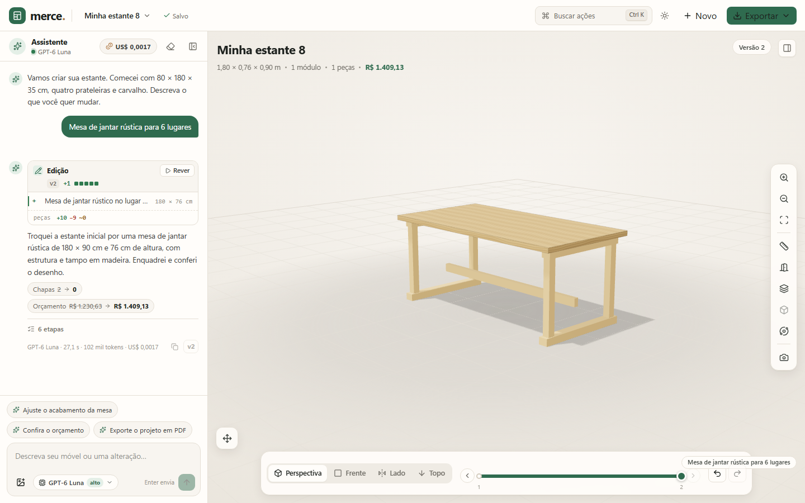

Cada resposta que mexe no projeto traz um bloco de **Edição**, como o diff de um editor: `+` entrou, `−` saiu, `~` mudou. Passar o mouse numa linha acende só as peças dela no 3D. Ao terminar o turno a cena toca as operações uma a uma, e **Rever** repete quando quiser (verde entrou, âmbar mudou, fantasma vermelho saiu).

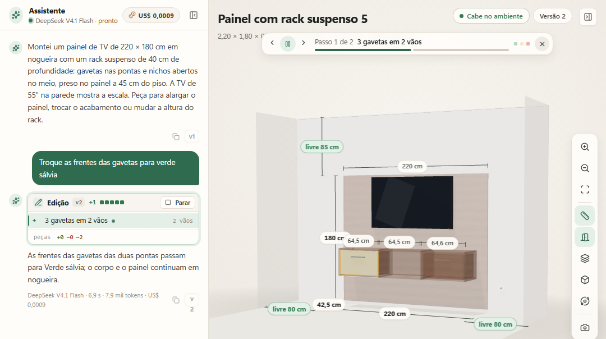

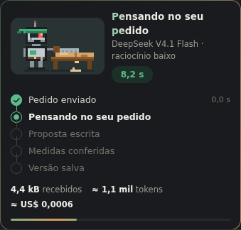

- **Enquanto trabalha**, o robô da Merce martela, serra ou fura na bancada e o cartão mostra o passo real, o relógio, os tokens e o custo. **Parar** interrompe sem mexer no projeto.
- **Sugestões, dúvidas e opções.** Os chips acima do campo são os próximos passos para este projeto. Quando falta uma decisão de verdade, a IA pergunta. Peça "me dê opções" e ela monta 2 ou 3 variantes lado a lado.
- **Copiar de uma foto.** Anexe ou cole uma imagem e peça para copiar o móvel ou o ambiente. A IA estima a escala, diz o erro esperado, monta e confere o próprio desenho contra a foto.
- **Cinco modelos.** Claude Haiku 5.5 com esforço baixo (padrão), GPT-6 Luna, DeepSeek V4.1 Flash, MiMo V2.6 Flash e Qwen 3.8 27B, com o preço à vista e o custo somado no topo.

<br clear="right">

### Doze estilos que vestem qualquer móvel

Um estilo é uma receita de materiais, frente, puxador, base e tampo. Ele veste qualquer móvel da biblioteca, de rack a guarda-roupa, cozinha e mesa.

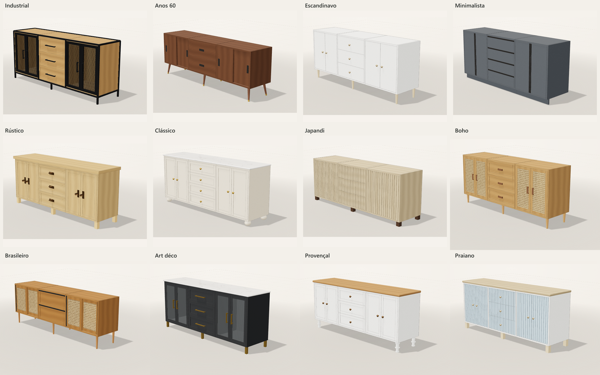

| Família | Estilos |
|---|---|
| Moderno | Anos 60 · Escandinavo · Minimalista · Japandi · Brasileiro |
| Natural e despojado | Rústico · Boho · Praiano |
| Urbano e sofisticado | Industrial · Art déco |
| Clássico e romântico | Clássico · Provençal |

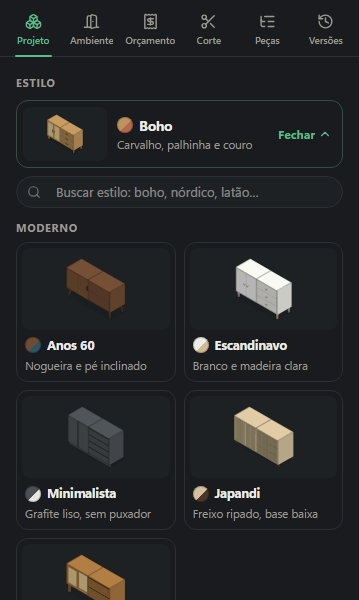

- **No projeto todo ou numa peça.** O estilo troca materiais e ferragens e guarda as medidas por fora: a caixa cede a altura que o pé, o tampo ou a moldura ganham.
- **Prévia antes de aplicar.** A cena mostra o resultado e as mudanças aparecem em chips; aplicar vira uma versão, e cancelar deixa tudo como estava.
- **Pela conversa.** "Quero um rack industrial" já sai no estilo certo, e "deixe tudo japandi" reestiliza o projeto.
- **Seletor em cartões.** Cada estilo mostra o desenho do mesmo aparador, o nome e uma dica ("Freijó e palhinha"). A busca acha pelas palavras das pessoas: "nórdico" acha o escandinavo e "latão" acha os estilos que usam latão.
- **Na biblioteca.** O mesmo seletor filtra os 30 móveis prontos pelo estilo.

Para criar um estilo, uma peça ou um material novo, veja o [guia de estilos](docs/STYLES.md).

<br clear="right">

### Frentes, puxadores, bases e tampos de verdade

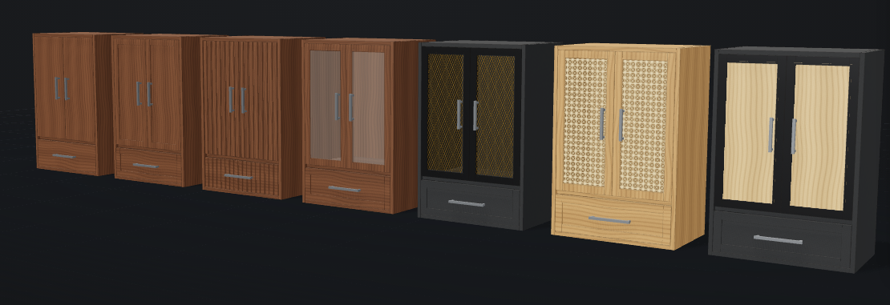

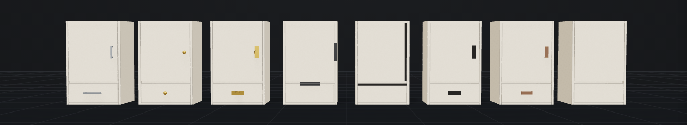

- **8 frentes:** lisa, com moldura, ripada, vidro com quadro, tela metálica, palhinha, almofada de madeira e chapa perfurada (no painel de parede).
- **8 puxadores:** barra, botão, concha, perfil de borda, cava usinada, recorte na frente, alça de couro e sem puxador (toque).
- **16 pés e bases:** palito, cônico, inclinado, quadrado, torneado, bola, grampo, tubo quadrado, cano, trenó de aço, estrutura de aço, cavalete, rodapé recuado, base aparente, rodízios e presa na parede.
- **Portas** de giro (uma ou duas folhas), de correr em dois trilhos e basculantes, além de gavetas.
- **Tampo sobreposto** com borda reta, arredondada ou chanfrada, **moldura no topo**, **contorno de aço**, **fundo em outra cor** e **fita de LED**.
- **31 materiais em seis famílias:** 14 chapas de MDF, 6 madeiras maciças, 4 metais, 3 vidros, 3 pedras e palhinha. Cada um entra só onde cabe, e o veio da madeira, o vidro translúcido e o metal brilhante aparecem na cena.

### Mesas, bancos e estruturas abertas

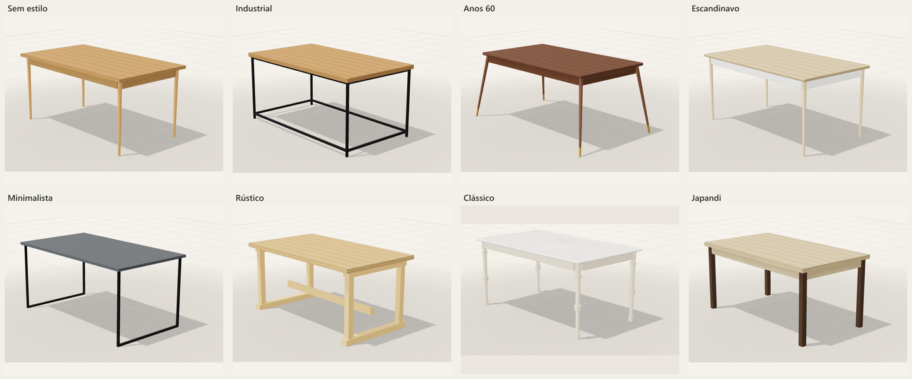

Mesa de jantar, de centro e lateral, console, escrivaninha (de piso ou suspensa), penteadeira, banco, carrinho de bar, entrada com banco e cabideiro e estante aberta de aço. Cada uma tem tampo, aventais, níveis e gavetas, e veste os mesmos estilos dos armários.

### Comece de um dos 30 móveis prontos

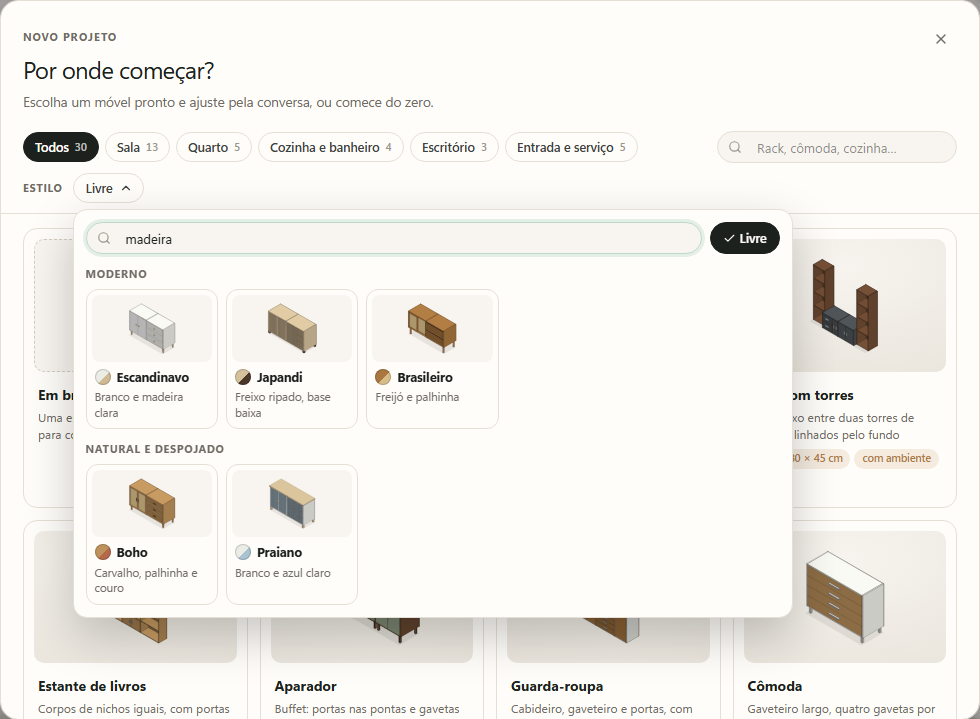

| Cômodo | Móveis |
|---|---|
| **Sala** (13) | Rack de TV, painel com rack suspenso, rack com torres, estante de livros, aparador, mesa de centro, mesa lateral, mesa de jantar, estante aberta de aço, carrinho de bar, adega, estante de TV com moldura, estante de nichos desencontrados |
| **Quarto** (5) | Guarda-roupa, cômoda, criado-mudo, cabeceira com criados suspensos, penteadeira |
| **Cozinha e banheiro** (4) | Cozinha linear, balcão de cozinha, armário aéreo, gabinete de banheiro |
| **Escritório** (3) | Armário de escritório, escrivaninha, escrivaninha suspensa |
| **Entrada e serviço** (5) | Sapateira, armário de lavanderia, console, banco, entrada com banco e cabideiro |

Cada um aceita largura, altura, profundidade, estilo e acabamentos dentro do próprio intervalo, e é montado pelo mesmo motor que a IA usa. Abra em **Novo** ou pela **Biblioteca de móveis** no painel, que encosta o móvel à esquerda ou à direita do que já existe.

### Veja o móvel no seu ambiente

Informe parede, pé-direito, profundidade, rodapé e obstáculos (porta, janela, tomada, TV, coluna) e a cena desenha o quarto com a mesma conta do veredito de encaixe. As paredes se põem, se movem e se esticam pelas alças na cena, com as cotas ao vivo. O cabeçalho diz se cabe, as cotas mostram as folgas, e um obstáculo que cruza o móvel fica vermelho.

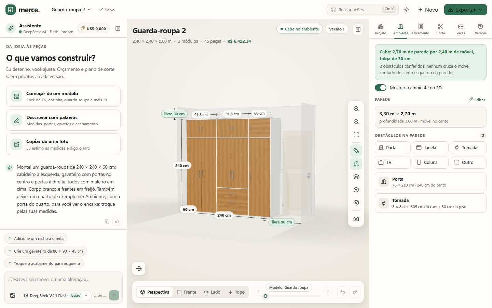

O móvel também se move: arraste uma peça ou use o controle **Mover** (setas de 1 cm, 10 cm com Shift, subir, descer, girar 90°). Módulos conectados andam juntos e grudam nas bordas dos vizinhos. No celular e no tablet o app mostra um espaço por vez, com a cena sempre à vista.

### Orçamento e plano de corte a cada versão

| Orçamento | Plano de corte |
|---|---|
| 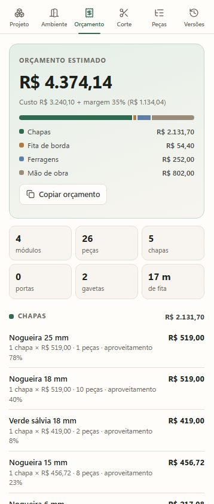 | 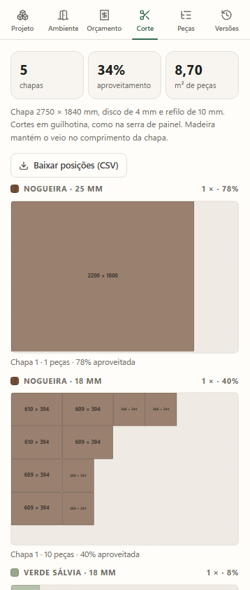 |

O **orçamento** conta as chapas pelo plano de corte, a madeira maciça em m³, pedra e vidro em m², o tubo de aço por metro, fita de borda, ferragens por tipo, usinagem das frentes, mão de obra e margem. Mostra a diferença para a versão anterior, o preço se edita na própria linha e "ver no móvel" acende as peças de cada item.

O **plano de corte** encaixa as chapas em guilhotina por material e espessura, com disco, refilo e veio travado. Cada chapa aparece em escala, com réguas, peças numeradas e sobras; passar o mouse numa peça acende ela no móvel com o tracejado de "corte aqui".

### Exporte para a marcenaria

| Formato | O que leva |
|---|---|
| **Foto da vista** | PNG com cotas e legenda |
| **Imprimir / PDF** | Capa com a foto, vista frontal cotada, orçamento, peças por material e as chapas |
| **Lista de peças** | CSV, uma linha por peça física |
| **Plano de corte** | CSV com as posições em cada chapa |
| **Cortecloud** | JSON (experimental) |
| **Projeto completo** | JSON com o histórico |

`Ctrl+K` abre a paleta de comandos; uma frase que não é comando vira pedido para a IA.

## Como rodar

```powershell
npm install
npm run dev        # http://127.0.0.1:4310
```

Ou use `Start-Merce.cmd`. Para produção local: `npm run build` e `npm start`. Não rode dois servidores na mesma porta, e reinicie o servidor depois de um `npm run build`: sem isso a página trava em "Montando o estúdio…" porque o navegador recebe um pacote misturado.

<details>
<summary><strong>Configurar a IA</strong></summary>

Copie `.env.example` para `.env` (ignorado pelo Git):

```dotenv
AI_API_KEY=your-key-here
AI_BASE_URL=https://api.commandcode.ai/provider/v1
AI_MODEL=deepseek/deepseek-v4.1-flash
```

A chave fica somente no servidor. O modelo padrão é o Claude Haiku 5.5 (`CLAUDE_API_KEY`, modelo `AI_HAIKU_MODEL`, padrão `claude-haiku-5-5`) pela API da Anthropic, com esforço `low`. O GPT-6 Luna (`AI_LUNA_MODEL`, padrão `gpt-6-luna`) segue no gateway com `reasoning_effort: high`; o DeepSeek V4.1 Flash (`AI_MODEL`) segue selecionável com `low`, o piso do gateway. `MERCE_REASONING_EFFORT` troca o esforço de todos, e `/api/health` diz o padrão e o esforço que vai de fato. A escolha de modelo fica salva no navegador.

A janela de inatividade é de 120 segundos, reiniciada a cada trecho recebido. Formato inválido ou lote recusado pela geometria gera até duas novas tentativas, com o motivo devolvido ao modelo. O teto é de 16000 tokens. Ajuste com `MERCE_AI_TIMEOUT_MS` e `MERCE_AI_MAX_TOKENS`.

O modo rápido opcional usa `AI_FAST_*`, e o preço de cada modelo vem de `lib/models.ts`, ajustável com `MERCE_PRICE_*`. Quando o provedor falha duas vezes com o DeepSeek, a Luna assume como reserva (`MERCE_FALLBACK_MODEL` troca a reserva, `none` desliga). O assistente em laço é o modo padrão; `MERCE_AGENT=0` volta ao modo de uma resposta só. O botão "Ao vivo" no compositor mostra o texto parcial da IA enquanto chega, para depuração.

</details>

<details>
<summary><strong>Projetos de demonstração</strong></summary>

`npm run demos` grava cinco projetos prontos para mostrar o app: painel de TV com rack suspenso, guarda-roupa, cozinha compacta, home office e lavanderia. O nome de cada um começa com "Demo ·". Cada demo nasce de um modelo da biblioteca e passa por algumas sessões de pedidos, todas aplicadas pelo motor do app, então histórico, Edição, orçamento, corte e exportações abrem como num projeto real. A receita fica em `lib/demos.ts`.

Antes de escrever, o comando copia a base para `data/merce-before-demos-<hora>.sqlite`. Rodar de novo devolve as demos ao estado original, sem duplicar. `npm run demos -- --replace` também apaga os projetos que não são demo. Recarregue a página depois de gravar.

</details>

<details>
<summary><strong>Mostrar para outras pessoas por um túnel</strong></summary>

Um túnel rápido do Cloudflare publica um endereço `https://algo.trycloudflare.com` enquanto o processo estiver vivo:

```powershell
cloudflared tunnel --url http://127.0.0.1:4310 --http-host-header 127.0.0.1:4310
```

O `--http-host-header` é obrigatório: sem ele o servidor de desenvolvimento responde 403. Atenção: o endereço não tem senha, dá leitura e escrita a todos os projetos da base local e cada turno gasta créditos do provedor. Para algo permanente, use a versão publicada abaixo.

</details>

## Publicação e versões

O app publicado fica em **[merce.lucferreira14.workers.dev](https://merce.lucferreira14.workers.dev)**, no plano gratuito da Cloudflare, protegido por senha.

```
push no dev   ─►  testes, lint e tipos
push no main  ─►  testes  ─►  publica na Cloudflare  ─►  confere o site  ─►  release (se a versão mudou)
```

- **Deploy automático.** O GitHub Actions publica cada push no `main`. O selo no topo e a lateral **Deployments** mostram o último resultado. Projetos e fotos ficam entre deploys.
- **Releases.** Subir a versão no `package.json` cria a release no deploy seguinte, com as notas de `docs/releases/vX.Y.Z.md`. Todas estão em [Releases](https://github.com/lucferreira-27/MercePOC/releases).
- **Na mão.** `npm run cf:deploy` publica da máquina e `npm run cf:secrets` envia as chaves e a senha. Como funciona e os limites estão em [docs/cloudflare.md](docs/cloudflare.md).

## Guia de uso

1. Crie um projeto em **Novo**: em branco ou a partir de um modelo, já no estilo que quiser. O seletor superior abre projetos existentes, com busca por nome.
2. Adicione Estante, Nicho, Rack ou Gaveteiro na aba **Projeto**, ou um móvel inteiro pela **Biblioteca de móveis**.
3. Selecione módulo ou compartimento na árvore, ou peça no 3D. A seleção aparece no chat e brilha na cena.
4. Ajuste medidas, posição, estilo, acabamento, base, puxador e frente nas propriedades. Conecte e alinhe módulos; um painel compartilhado exige faces iguais e afastamento zero, e "Separar módulos" desfaz a ligação.
5. Divida compartimentos e configure portas (de giro, de correr ou basculante) e gavetas. Abra e feche as frentes pelo painel, pelo chat ou todas de uma vez (`O`).
6. Arraste a linha do tempo para consultar ou restaurar versões; orçamento e corte acompanham a versão exibida. **Criar alternativa desta versão**, em **Versões**, preserva os dois caminhos.
7. Informe o **Ambiente** para ver o quarto no 3D, as folgas nas cotas e o veredito de encaixe.
8. Veja o custo em **Orçamento** e as chapas em **Corte**. A tabela de preços vale para todos os projetos deste navegador.
9. Em **Exportar**, escolha foto, PDF, CSVs, Cortecloud ou JSON.

Exemplos de pedido: "Faz um rack de TV de 2 m em nogueira"; "Quero um aparador anos 60"; "Mesa de jantar rústica para 6 lugares"; "Deixe tudo no estilo japandi"; "Copie o layout desta foto"; "Coloque três gavetas embaixo e duas portas de correr em cima"; "Troque os puxadores por cava"; "Quanto custa e quantas chapas usa?".

<details>
<summary><strong>Obstáculos e paredes, em detalhe</strong></summary>

Na aba **Ambiente**, escolha o tipo (porta, janela, tomada, TV, coluna ou outro). A prévia translúcida aparece no primeiro lugar livre da parede e segue o cursor, com a distância do canto e do piso; clique para pôr, ou ajuste com as setas (10 cm, 1 cm com Shift) e confirme com Enter. Esc desiste.

A moldura fica verde no lugar livre, âmbar na frente do móvel (pode, e o veredito acusa) e vermelha em cima de outro obstáculo (não pode). Clique num obstáculo na cena ou na lista para editar, remover ou arrastar; `Delete` remove e o aviso na cena tem **Desfazer**. As paredes têm alças na cena para mover e esticar, com as cotas de comprimento e altura ao vivo.

Cada mudança no ambiente é uma versão ("Pôs a porta", "Moveu a janela", "Medidas da parede"), e arrastos seguidos do mesmo obstáculo ficam numa versão só. A IA também põe, move e tira obstáculos.

</details>

<details>
<summary><strong>Mover o móvel, em detalhe</strong></summary>

Selecione uma peça e arraste-a na cena. O conjunto inteiro anda junto (módulos conectados vão com a raiz), em passos de 1 cm, grudando nas bordas dos vizinhos e voltando ao lugar se bater em outro móvel. Por padrão a altura fica travada; o cadeado do controle **Mover** solta a altura e **Um eixo** deixa só a direção dominante. Shift+clique tira o móvel da seleção.

A parede fica parada: no primeiro movimento ela é presa no lugar, e desfazer devolve o móvel, não a parede. Movimentos seguidos do mesmo móvel ficam numa versão só, "Moveu …": `Ctrl+Z` volta um movimento por vez. Uma pausa de mais de 2 minutos, outro móvel, outra edição ou um turno da IA começam uma versão nova.

</details>

<details>
<summary><strong>Copiar de uma foto, em detalhe</strong></summary>

A IA estima a escala por objetos de tamanho conhecido (frente de gaveta ~200 mm, livro ~240 mm, pé-direito ~2600 mm), mantém as proporções, arredonda para 10 mm, respeita os limites do motor e monta a fileira inteira no mesmo turno. Ela diz a régua que usou, o erro esperado (±10 a 20%), o que a foto mostra e o editor não tem (curva, canto com interior contínuo) e qual medida sua fecharia o desenho.

Assim que a foto é anexada, um classificador rápido (Perplexity Decisions, ~1 s) diz o modelo da biblioteca mais parecido, o ambiente, o estilo, a cor do corpo e faixas de medida. Isso aparece como etiquetas na foto, com "?" no que é incerto, e a IA começa o desenho por ali. Sem `PERPLEXITY_API_KEY` no `.env`, ou se o classificador falhar, a foto segue como antes.

Depois de aplicar, ela recebe o desenho do resultado (frontal e isométrica), confere contra a foto e responde "ficou parecido/em parte/diferente", com até 10 operações de correção. Num desenho de linhas não dá para julgar cor nem textura, e a conferência não inventa isso. Aceita JPG, PNG ou WebP até 10 MB.

</details>

### Atalhos

| Tecla | Ação |
|---|---|
| `Ctrl+K` | Paleta de comandos |
| `/` | Escrever para a IA |
| `1` `2` `3` `4` | Perspectiva, frontal, lateral, topo |
| `F` · `+` · `-` | Enquadrar, aproximar, afastar |
| Setas · `PageUp` `PageDown` | Mover o móvel selecionado 1 cm (10 cm com `Shift`), subir, descer |
| `D` · `R` · `E` · `O` | Cotas, ambiente, explodir, abrir/fechar frentes |
| `[` · `]` | Recolher conversa, recolher painel |
| `Ctrl+Z` · `Ctrl+Y` | Desfazer, refazer |
| `Delete` | Remover o obstáculo escolhido na parede |
| `Esc` | Limpar seleção, desistir de pôr um obstáculo, cancelar prévia, fechar a revisão das mudanças |

## Limites e dados

| Item | Limite |
|---|---|
| Projeto | Até 12 módulos, 200 painéis físicos e 32 compartimentos finais por módulo |
| Módulo (caixa) | Largura 200–1200, altura 200–2400, profundidade 200–800 mm; vãos de 100 mm no mínimo |
| Mesa e estrutura aberta | Largura 300–2700, profundidade 250–1200, altura 250–2400 mm; até 6 níveis e 4 gavetas |
| Painel e prateleira de parede | Painel até 2,70 × 1,80 m; prateleira até 2,70 m, 15 a 60 mm de espessura, 150 a 600 mm de fundo |
| Pés | 50 a 300 mm, com faixa própria por tipo; rotação em passos de 90° |

Ainda não inclui curvas, painéis inclinados, recortes livres, canto com interior contínuo, tampos avulsos, furação, ferragens comerciais nem certificação estrutural. Confira ferragens e furação com o marceneiro.

Os projetos ficam em SQLite, em `data/merce.sqlite` ou em `MERCE_DATA_DIR` (na Cloudflare, num Durable Object). Projetos em v1, v2 ou v3 migram na leitura e são gravados em v4 no próximo salvamento.

CSV UTF-8 com BOM e `;`, uma linha por peça física; painel compartilhado aparece uma vez, com dois proprietários. O plano de corte é um encaixe em guilhotina honesto, não o ótimo matemático, e o orçamento é estimativa com preços de partida em reais (chapa 2750 × 1840 mm).

Mais em [regras e arquitetura](docs/MODULAR.md), [resultados da validação](docs/MODULAR-VALIDATION.md) e no [guia de estilos](docs/STYLES.md).

## Desenvolvimento

```powershell
npm test            # suíte node:test via tsx
npm run lint        # oxlint
npm run typecheck   # tsc --noEmit
npm run build
npm run test:live   # turno real com o modelo configurado
```

`npm run bench` mede o par prompt + modelo + validação, soma o custo e compara execuções (`--compare`); `--model haiku|deepseek|luna|mimo|qwen-fast` escolhe o modelo. `bench:router`, `bench:claims` e `bench:askact` medem o roteador, a conferência do que a resposta afirma e o portão de perguntar ou fazer; `bench:dash` abre o painel. O catálogo fica em [bench/README.md](bench/README.md).

<details>
<summary><strong>Verificações em navegador real</strong></summary>

Com o app rodando em `127.0.0.1:4310`:

| Script | O que confere |
|---|---|
| `node work/qa/verify-boot.mjs` | Abertura do zero (hidratação, cena 3D, painel) e o aviso de "recarregue a página" |
| `node work/qa/verify-chat-ui.mjs` | Chips da IA, cartão de dúvida e roteiro de etapas, com dois turnos reais |
| `node work/qa/verify-change-cards.mjs` | Cartões de mudança com um turno real e um projeto semeado |
| `node work/qa/verify-composer.mjs` | Rodapé do compositor de 360 a 1280 px |
| `node work/qa/verify-selection.mjs` | Shift+clique puxa o módulo inteiro e o pedido leva a seleção ao servidor |
| `node work/qa/verify-foto.mjs` | Cópia de layout a partir de uma foto real, com a conferência do próprio desenho |

`node --import tsx scripts/modular-ui.mjs` grava screenshots e exportações em `outputs/modular`. Requer Playwright; opcionalmente defina `PLAYWRIGHT_MODULE` e `BROWSER_EXECUTABLE`.

</details>

<sub>As imagens deste README estão em `docs/readme/` e foram capturadas do app rodando. A v1, o protótipo que levava da conversa ao 3D, está na release `v1`.</sub>
