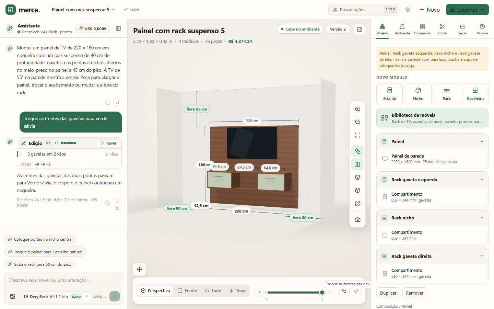
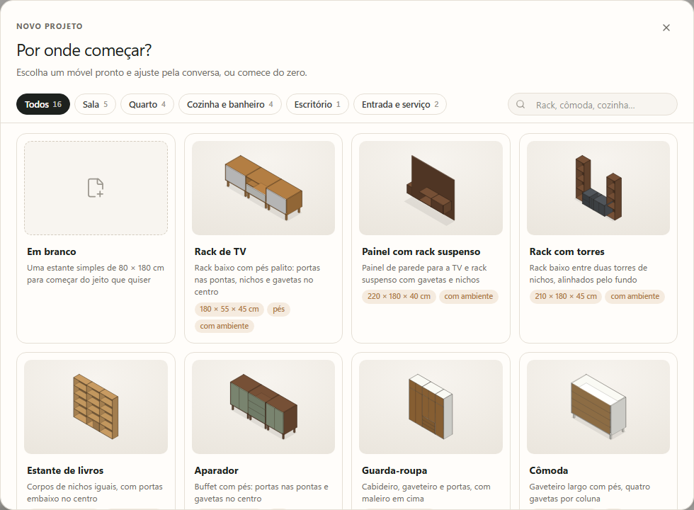
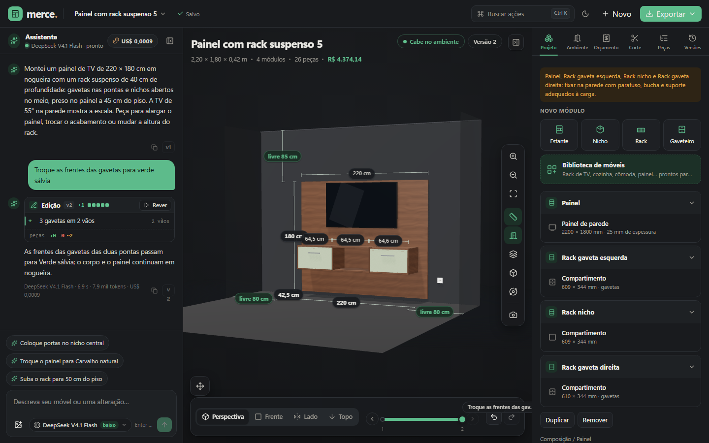

# Merce

Estúdio local de móveis planejados com painéis retos. Você descreve o móvel na conversa, parte de um modelo pronto ou monta no editor, e o estúdio devolve o desenho em 3D no seu ambiente, o orçamento, o plano de corte e as exportações para a marcenaria. Chat, editor, cena 3D, histórico, orçamento e corte leem a mesma composição (schema v3), então tudo acompanha cada versão.



## O que ele faz

### Comece de um móvel pronto

A biblioteca tem 16 móveis paramétricos, por cômodo: rack de TV com pés palito, painel com rack suspenso, rack com torres, estante, aparador, guarda-roupa, cômoda, criado-mudo, cabeceira com criados suspensos, cozinha linear, balcão, armário aéreo, gabinete de banheiro, armário de escritório, sapateira e armário de lavanderia. Cada um aceita largura, altura, profundidade, acabamentos e pés dentro do próprio intervalo, e é montado pelo mesmo motor que o chat usa. Abra em **Novo** (projeto novo, com ambiente de exemplo) ou pela **Biblioteca de móveis** no painel, que encosta o móvel à esquerda ou à direita do que já existe.



### Converse com a IA, veja cada mudança

O assistente trabalha em laço com as ferramentas do próprio estúdio: desenha, mede a parede, monta fileiras, põe peças ao lado, acima ou abaixo de outras, troca vista e abas, ajusta preços e gera arquivos. Antes de responder, o app confere o encaixe, as frentes e o que a resposta afirma contra o que o pedido quer. O pedido inteiro vira uma versão, e `Ctrl+Z` desfaz tudo de uma vez. Cada resposta que mexe no projeto traz um bloco de **Edição**, como o diff de um editor: `+` entrou, `−` saiu, `~` mudou. Passar o mouse numa linha acende só as peças dela no 3D; clicar abre medidas, posição, frentes e acabamento. Ao terminar o turno a cena toca as operações uma a uma, com a linha da vez acesa na conversa, e **Rever** repete quando quiser (verde entrou, âmbar mudou, fantasma vermelho saiu).


Enquanto a IA trabalha, o robô da Merce martela, serra ou fura na bancada e o cartão mostra o passo real (enviado, pensando, escrevendo, conferindo medidas, comparando com a foto, salvando), o relógio, os dados que chegam, os tokens e o custo. **Parar** interrompe sem mexer no projeto.

- **Sugestões, dúvidas e opções.** Os chips acima do campo são os próximos passos que a IA propõe para este projeto. Quando falta uma decisão de verdade, o cartão mostra a pergunta, respostas sugeridas e um campo livre. Peça "me dê opções" e ela monta 2 ou 3 variantes lado a lado: uma vira a versão atual, as outras ficam como alternativa.
- **Copiar de uma foto.** Anexe ou cole uma imagem (JPG, PNG ou WebP, até 10 MB) e peça para copiar o layout. A IA estima a escala por objetos conhecidos, diz a régua que usou e o erro esperado, monta a fileira inteira e depois confere o próprio desenho contra a foto, corrigindo o que ficou diferente.
- **Modelos e custo.** O padrão é o GPT-6 Luna com raciocínio alto. O seletor também traz DeepSeek V4.1 Flash, MiMo V2.6 Flash e Qwen 3.8 27B, com o preço à vista, e o selo no topo soma o custo da conversa e da aba.

<br clear="right">

### Veja o móvel no seu ambiente

Informe parede, pé-direito, profundidade, rodapé e obstáculos (porta, janela, tomada, TV, coluna) e a cena desenha o quarto com a mesma conta do veredito de encaixe. O cabeçalho diz se cabe, as cotas mostram as folgas até a parede e o teto, um obstáculo que cruza o móvel fica vermelho e a tela da TV também, quando algo a tapa. Obstáculos entram com prévia no lugar livre, se arrastam na cena e cada mudança vira uma versão que dá para desfazer.


O móvel também se move: selecione uma peça e arraste, ou use o controle **Mover** (setas de 1 cm, 10 cm com Shift, subir, descer, girar 90°). Módulos conectados andam juntos, grudam nas bordas dos vizinhos e voltam se baterem em outro móvel.

### Orçamento e plano de corte a cada versão

| Orçamento | Plano de corte |
|---|---|
|  |  |

O **orçamento** conta chapas pelo plano de corte, fita de borda, dobradiças pela altura da folha, corrediças, puxadores, mão de obra e margem. Mostra a diferença para a versão anterior, o preço unitário se edita na própria linha e "ver no móvel" acende as peças de cada item.

O **plano de corte** encaixa em guilhotina por material e espessura, com disco, refilo e veio travado no comprimento da chapa. Cada chapa aparece em escala, com réguas, peças numeradas e sobras aproveitáveis; passar o mouse numa peça acende ela no móvel com o tracejado de "corte aqui". A aba **Peças** agrupa por módulo, material ou tipo, com fita de borda e o número no plano. A IA responde "quanto custa" e "quantas chapas" com os mesmos números.

### Claro e escuro

Nove acabamentos (branco fosco, areia, carvalho natural, freijó, nogueira, verde sálvia, azul petróleo, grafite e preto fosco), veio de madeira procedural, luz de estúdio e dois temas, do sistema ou escolhido na barra superior. Conversa e painel recolhem (`[` e `]`) para a cena ocupar o espaço.



### Exporte para a marcenaria

Foto PNG da vista com cotas e legenda, PDF (capa com a foto, vista frontal cotada, orçamento por seção, peças por material e as chapas com o mesmo desenho da aba Corte), lista de peças em CSV, plano de corte em CSV, Cortecloud (experimental) e o projeto completo em JSON. `Ctrl+K` abre a paleta de comandos; uma frase que não é comando vira pedido para a IA.

## Executar

Use `Start-Merce.cmd`, ou `npm install` e `npm run dev` em `G:\MercePOC`. Abra http://127.0.0.1:4310/. Para produção local: `npm run build` e `npm start`. Não execute dois servidores na mesma porta.

`npm run build` reescreve o pacote que o servidor em execução está servindo. Se o servidor já estava de pé, reinicie-o depois do build; sem isso a página trava em "Montando o estúdio…" porque o navegador recebe um pacote misturado e não hidrata. `npm run dev` (HMR na mesma porta) não tem esse problema.

### Configurar a IA

Copie `.env.example` para `.env` (ignorado pelo Git):

```dotenv
AI_API_KEY=your-key-here
AI_BASE_URL=https://api.commandcode.ai/provider/v1
AI_MODEL=deepseek/deepseek-v4.1-flash
```

A chave fica somente no servidor. O modelo padrão é o GPT-6 Luna (`AI_LUNA_MODEL`, padrão `gpt-6-luna`) no mesmo gateway, com `reasoning_effort: high`; o DeepSeek V4.1 Flash (`AI_MODEL`) segue selecionável com `low`, o piso do gateway. `MERCE_REASONING_EFFORT` troca o esforço de todos, e `/api/health` diz o padrão e o esforço que vai de fato. A escolha de modelo fica salva no navegador. A janela de inatividade é de 120 segundos, reiniciada a cada trecho recebido: uma resposta lenta mas viva termina, e uma conexão muda é encerrada. Formato inválido ou lote recusado pela geometria gera até duas novas tentativas, com o motivo devolvido ao modelo. O teto é de 16000 tokens; com menos, pedidos de várias operações esgotam o orçamento em raciocínio e voltam truncados. Ajuste com `MERCE_AI_TIMEOUT_MS` e `MERCE_AI_MAX_TOKENS`.

O modo rápido opcional usa `AI_FAST_*`, e o preço de cada modelo vem de `lib/models.ts`, ajustável com `MERCE_PRICE_*`. Quando o provedor falha duas vezes com o DeepSeek, a Luna assume como reserva (`MERCE_FALLBACK_MODEL` troca a reserva, `none` desliga). Erros de rede ou limite do provedor preservam o projeto e permitem reenviar. O assistente em laço é o modo padrão; `MERCE_AGENT=0` no servidor volta ao modo de uma resposta só, que a cópia de foto ainda usa. O botão "Ao vivo" na barra do compositor é uma opção de depuração que mostra o texto parcial da IA enquanto chega; nada disso é salvo nem volta ao modelo.

### Mostrar para outras pessoas

Um túnel rápido do Cloudflare publica um endereço `https://algo.trycloudflare.com` enquanto o processo estiver vivo:

```powershell
cloudflared tunnel --url http://127.0.0.1:4310 --http-host-header 127.0.0.1:4310
```

O `--http-host-header` é obrigatório: sem ele o servidor de desenvolvimento responde 403 "Blocked request" e nada chega ao app. A checagem de origem compara com o host do pedido (`x-forwarded-host`), então a escrita funciona pelo domínio público. Atenção: o endereço não tem senha, dá leitura e escrita a todos os projetos da base local e cada turno gasta créditos do provedor. Compartilhe só com quem deve ver e encerre o túnel depois.

## Guia de uso

1. Crie um projeto em **Novo**: em branco ou a partir de um modelo. O seletor superior abre projetos existentes, com busca por nome e exclusão por linha.
2. Adicione Estante, Nicho, Rack ou Gaveteiro na aba **Projeto**, ou um móvel inteiro pela **Biblioteca de móveis**.
3. Selecione módulo ou compartimento na árvore, ou peça no 3D. A seleção aparece no chat e brilha na cena.
4. Ajuste medidas, posição, orientação, acabamento e fundo nas propriedades. Conecte e alinhe módulos, compartilhe uma face compatível ou separe antes de mover um filho livremente. Um painel compartilhado exige faces iguais e afastamento zero; para mudar só um dos lados, use "Separar módulos" primeiro.
5. Selecione compartimentos para dividir, mover ou distribuir divisões e configurar portas e gavetas, com acabamento próprio na frente. Abra e feche as frentes pelo painel, pelo chat ou todas de uma vez (`O`); abrir não cria versão.
6. Arraste a linha do tempo para consultar ou restaurar versões; orçamento e corte acompanham a versão exibida. Editar a partir do passado cria um novo caminho, e **Criar alternativa desta versão**, em **Versões**, preserva os dois.
7. Informe o **Ambiente** para ver o quarto no 3D, as folgas nas cotas e o veredito de encaixe.
8. Veja o custo em **Orçamento** e as chapas em **Corte**. A tabela de preços vale para todos os projetos deste navegador.
9. Em **Exportar**, escolha foto, impressão, CSVs, Cortecloud ou JSON. O nome do projeto se edita clicando no título acima do 3D.

Exemplos de pedido: "Faz um rack de TV de 2 m em nogueira"; "Quero um painel de TV com rack suspenso"; "Coloque um criado-mudo à direita"; "Copie o layout desta foto"; "Divida este compartimento em duas colunas"; "Coloque três gavetas embaixo e duas portas em cima"; "Troque as frentes para verde sálvia"; "Coloque uma porta à direita"; "Quanto custa e quantas chapas usa?".

<details>
<summary><strong>Obstáculos na parede, em detalhe</strong></summary>

Na aba **Ambiente**, escolha o tipo (porta, janela, tomada, TV, coluna ou outro). A prévia translúcida aparece no primeiro lugar livre da parede e segue o cursor, com a distância do canto e do piso; clique para pôr, ou ajuste com as setas (10 cm, 1 cm com Shift) e confirme com Enter. Esc desiste. Sem ambiente salvo, a parede do formulário entra junto.

A moldura fica verde no lugar livre, âmbar na frente do móvel (pode, e o veredito acusa) e vermelha em cima de outro obstáculo (não pode). Clique num obstáculo na cena ou na lista para escolher: a barra sobre ele tem editar, remover e fechar, e a lista abre as medidas com prévia no 3D enquanto digita. Arraste para mudar de lugar; `Delete` remove e o aviso na cena tem **Desfazer**.

Cada mudança no ambiente é uma versão ("Pôs a porta", "Moveu a janela", "Tirou a TV", "Medidas da parede"). `Ctrl+Z`, `Ctrl+Y` e abrir uma versão no histórico trazem de volta os obstáculos que ela tinha, e arrastos seguidos do mesmo obstáculo ficam numa versão só. A IA também põe, move e tira obstáculos.

</details>

<details>
<summary><strong>Mover o móvel, em detalhe</strong></summary>

Selecione uma peça e arraste-a na cena. O conjunto inteiro anda junto (módulos conectados vão com a raiz), em passos de 1 cm, grudando nas bordas dos vizinhos e voltando ao lugar se bater em outro móvel. Por padrão a altura fica travada e o arrasto desliza no piso; o cadeado do controle **Mover** solta a altura e **Um eixo** deixa só a direção dominante. Shift+clique tira o móvel da seleção.

A parede fica parada: no primeiro movimento ela é presa no lugar, então dá para afastar o móvel dela, e desfazer devolve o móvel, não a parede. Movimentos seguidos do mesmo móvel ficam numa versão só, "Moveu …": `Ctrl+Z` volta um movimento por vez e `Ctrl+Y` refaz. Uma pausa de mais de 2 minutos, outro móvel, outra edição ou um turno da IA começam uma versão nova.

</details>

<details>
<summary><strong>Copiar de uma foto, em detalhe</strong></summary>

A IA estima a escala por objetos de tamanho conhecido (frente de gaveta ~200 mm, livro ~240 mm, pé-direito ~2600 mm), mantém as proporções, arredonda para 10 mm, respeita os limites do motor e monta a fileira inteira no mesmo turno, com os módulos ligados e as divisões antes das frentes. Ela diz a régua que usou, o erro esperado (±10 a 20%), o que a foto mostra e o editor não tem (cabideiro, curva, porta de correr, canto com interior contínuo) e qual medida sua fecharia o desenho.

Depois de aplicar, ela recebe o desenho do resultado (frontal e isométrica), confere contra a foto e responde "ficou parecido/em parte/diferente", com até 10 operações de correção. O desenho conferido aparece na conversa. Num desenho de linhas não dá para julgar cor, textura nem ferragem, e a conferência não inventa isso. Sem pedido de cópia, a imagem é só referência visual.

</details>

### Atalhos

| Tecla | Ação |
|---|---|
| `Ctrl+K` | Paleta de comandos |
| `/` | Escrever para a IA |
| `1` `2` `3` `4` | Perspectiva, frontal, lateral, topo |
| `F` · `+` · `-` | Enquadrar, aproximar, afastar |
| Setas · `PageUp` `PageDown` | Mover o móvel selecionado 1 cm (10 cm com `Shift`), subir, descer |
| `D` · `R` · `E` · `O` | Cotas, ambiente, explodir, abrir/fechar frentes |
| `[` · `]` | Recolher conversa, recolher painel |
| `Ctrl+Z` · `Ctrl+Y` | Desfazer, refazer |
| `Delete` | Remover o obstáculo escolhido na parede |
| `Esc` | Limpar seleção, desistir de pôr um obstáculo, cancelar prévia do histórico, fechar a revisão das mudanças |

## Limites e dados

Até 12 módulos, 200 painéis físicos e 32 compartimentos finais por módulo. Medidas externas de cada módulo: largura 200–1200, altura 200–2400, profundidade 200–800 mm; o painel de parede vai até 2,70 × 1,80 m e a prateleira de parede até 2,70 m de comprimento (15 a 60 mm de espessura, 150 a 600 mm de fundo). Vãos mínimos de 100 mm. Pés de 50 a 300 mm. Rotação em passos de 90°. O L usa módulos retangulares separados.

Não inclui curvas, inclinados, recortes, canto com interior contínuo, portas de correr ou basculantes, mesas, tampos avulsos, furação, ferragens comerciais ou certificação estrutural.

Os projetos ficam em SQLite, em `data/merce.sqlite` ou em `MERCE_DATA_DIR`. Bancos antigos recebem backup em `merce-before-modules.sqlite`, e revisões v1/v2 são migradas na leitura e gravadas em v3 no próximo salvamento.

CSV UTF-8 com BOM e `;`, uma linha por peça física; painel compartilhado aparece uma vez, com dois proprietários. CSV e Cortecloud usam a posição fechada. O plano de corte é um encaixe em guilhotina honesto, não o ótimo matemático, e o orçamento é estimativa com preços de partida em reais (chapa 2750 × 1840 mm). O adaptador Cortecloud é experimental, e reimportar JSON pela interface fica fora da POC.

Mais em [regras e arquitetura](docs/MODULAR.md) e [resultados da validação](docs/MODULAR-VALIDATION.md). A v1, que levava da conversa ao 3D, está na tag `v1`.

## Desenvolvimento

```powershell
npm test            # suíte node:test via tsx
npm run lint        # oxlint
npm run typecheck   # tsc --noEmit
npm run build
npm run test:live   # turno real com o modelo configurado
```

`test:live` cria uma demonstração e grava `work/modular-live.json`. Para retomar após um limite temporário: `$env:RESUME_MODULAR='1'; npm run test:live`.

`npm run bench` mede o par prompt + modelo + validação em 51 casos, soma o custo e compara duas execuções (`--compare`); `--model deepseek|luna|mimo|qwen-fast` escolhe o modelo. `bench:router`, `bench:claims` e `bench:askact` medem o roteador, a conferência do que a resposta afirma e o portão de perguntar ou fazer; `bench:dash` abre o painel dos resultados. O catálogo e o que já aprendemos ficam em [bench/README.md](bench/README.md).

Verificações em navegador real, com o app rodando em `127.0.0.1:4310`:

| Script | O que confere |
|---|---|
| `node work/qa/verify-boot.mjs` | Abertura do zero (hidratação, cena 3D, painel) e o aviso de "recarregue a página" quando não hidrata |
| `node work/qa/verify-chat-ui.mjs` | Chips da IA, cartão de dúvida com campo livre e roteiro de etapas, com dois turnos reais |
| `node work/qa/verify-change-cards.mjs` | Cartões de mudança com um turno real e um projeto semeado |
| `node work/qa/verify-composer.mjs` | Rodapé do compositor de 360 a 1280 px |
| `node work/qa/verify-selection.mjs` | Shift+clique puxa o módulo inteiro e o pedido leva a seleção ao servidor |
| `node work/qa/verify-foto.mjs` | Cópia de layout a partir de uma foto real, com a conferência do próprio desenho |

`node --import tsx scripts/modular-ui.mjs` grava screenshots e exportações em `outputs/modular`. Requer Playwright; opcionalmente defina `PLAYWRIGHT_MODULE` com o caminho de `playwright/index.mjs` e `BROWSER_EXECUTABLE` com um Chromium, Chrome ou Brave.

As imagens deste README estão em `docs/readme/` e foram capturadas do app rodando.
